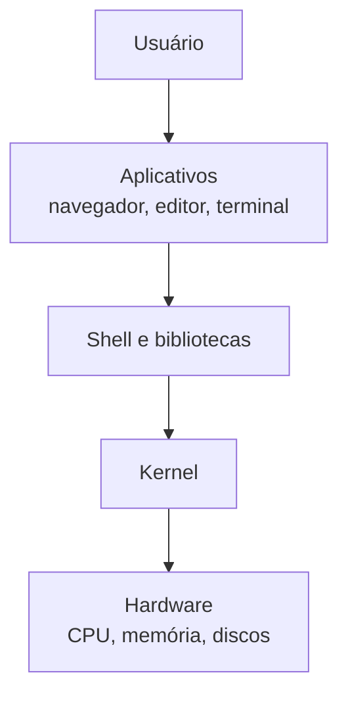

+++
title = "Sistema Operacional"
weight = 1
description = "O que é um sistema operacional e o que é o kernel."
+++

O **sistema operacional (SO)** é o conjunto de programas que faz a interface entre o
usuário (e seus programas) e o computador. Ele é responsável por:

- **Gerenciar recursos e periféricos**: memória, discos, arquivos, impressoras, rede, USB…
- **Interpretar comandos** do usuário;
- **Executar programas**, dividindo o processador entre eles.

## O kernel

O **kernel** (núcleo) é a base principal de um sistema operacional. É ele que conversa
diretamente com o hardware e oferece serviços para os demais programas.

{}
Tecnicamente, **Linux é apenas o kernel**. O sistema completo que usamos é a soma do kernel
Linux com ferramentas do projeto GNU e muitos outros programas — por isso o nome **GNU/Linux**.
{}
