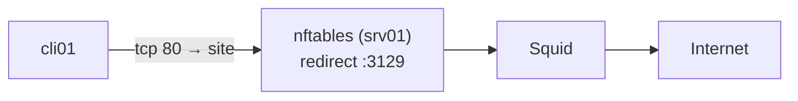

+++
title = "Proxy transparente"
weight = 4
description = "Redirecionar o HTTP para o Squid com nftables, sem configurar os clientes, e seus limites."
+++

No **proxy transparente**, os clientes não sabem que existe um proxy: o firewall do `srv01`
desvia para o Squid as conexões que iriam direto para a porta 80 da Internet.



## 1. Squid: uma porta para interceptação

No `/etc/squid/squid.conf`, mantenha a porta normal e acrescente uma porta só para o tráfego
interceptado:

```text
http_port 3128              # proxy explícito (continua funcionando)
http_port 3129 intercept    # tráfego redirecionado pelo firewall
```

{}
Tutoriais antigos (Squid 2.5) usavam `httpd_accel_host virtual`, `httpd_accel_port 80`,
`httpd_accel_with_proxy on` e `httpd_accel_uses_host_header on`. Elas não existem mais.
O `intercept` no `http_port` faz todo esse trabalho.
{}

```bash
sudo squid -k parse && sudo systemctl restart squid
```

## 2. nftables: redirecionar a porta 80

No `/etc/nftables.conf` do capítulo 2, acrescente uma chain `prerouting` à tabela `nat`:

```text
table ip nat {
    chain prerouting {
        type nat hook prerouting priority dstnat;
        iifname $LAN tcp dport 80 redirect to :3129
    }
    chain postrouting {
        type nat hook postrouting priority srcnat;
        oifname $WAN masquerade
    }
}
```

```bash
sudo nft -c -f /etc/nftables.conf && sudo systemctl reload nftables
```

O `redirect` troca o destino pelo próprio `srv01`. Por isso o pacote passa pela chain
**input** (e não pela `forward`). Se você tiver uma chain `input` com `policy drop`, libere
`iifname $LAN tcp dport 3129 accept`.

{}
Não redirecione o tráfego **do próprio Squid**. A regra acima casa só com o que entra pela
interface da LAN, então as conexões que o Squid abre para a Internet não entram em loop.
{}

## 3. Testar

No `cli01`, sem nenhuma configuração de proxy:

```bash
curl -I http://neverssl.com      # site que propositalmente não usa HTTPS
```

No `srv01`, a requisição aparece no `access.log`:

```bash
sudo tail -f /var/log/squid/access.log
```

## E o HTTPS?

Aqui está o grande limite: uma conexão HTTPS redirecionada chega ao Squid **cifrada**, sem
o pedido `CONNECT` que o proxy explícito recebe. Para tratá-la, o Squid precisa de
`https_port ... intercept ssl-bump`, um certificado próprio e regras `peek`/`splice` para ler
pelo menos o nome do site (SNI). É uma configuração avançada, que não abordaremos.

Na prática, como quase todo o tráfego é HTTPS, a combinação mais usada é:

1. **proxy explícito** distribuído aos clientes (manual, WPAD/PAC ou GPO);
2. **proxy transparente** só para o HTTP, pegando quem não está configurado;
3. o firewall **bloqueando** o encaminhamento direto da LAN para a porta 443 da Internet,
   para que ninguém "pule" o proxy:

```text
# na chain forward, antes do "iifname $LAN oifname $WAN accept"
iifname $LAN oifname $WAN tcp dport 443 reject
```

## Exercícios

1. Ative a interceptação e confirme, pelo `access.log`, que o `cli01` passa pelo Squid sem
   configuração de proxy.
2. Bloqueie um site HTTP com uma ACL `dstdomain` e veja a página de erro do Squid no `cli01`.
3. Tente acessar um site HTTPS pelo `cli01` sem proxy configurado, antes e depois de
   bloquear a porta 443 no `forward`. Explique a diferença.
